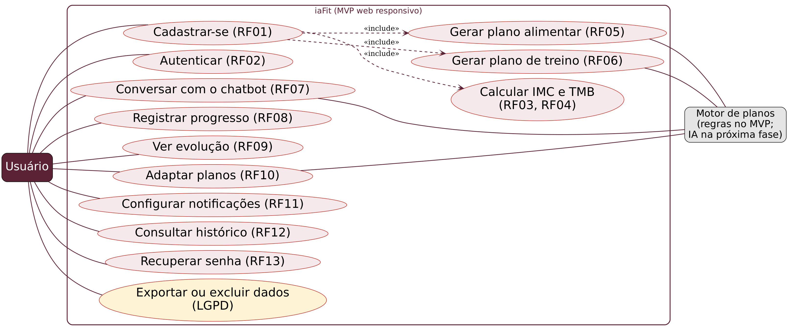
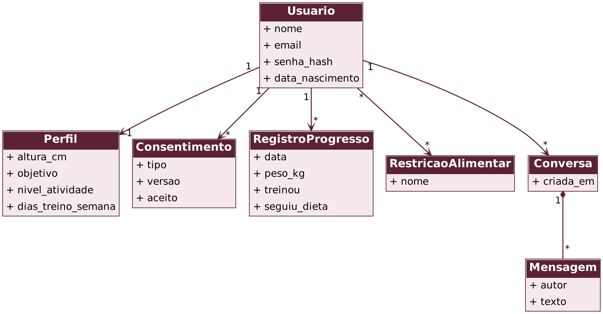
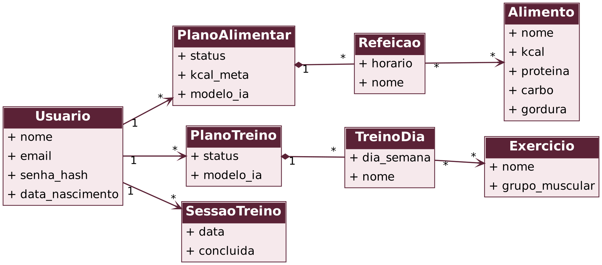
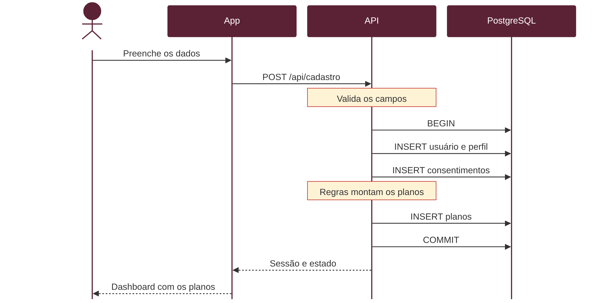
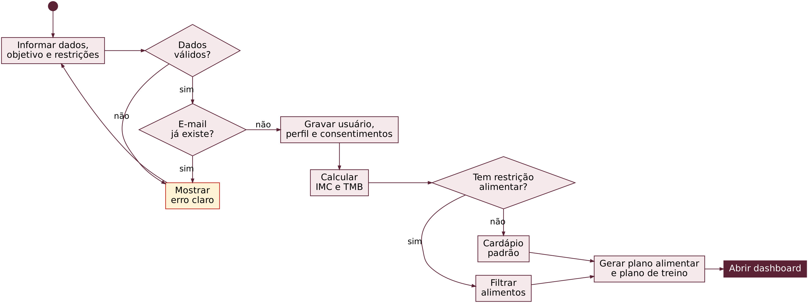

# iaFit

Aplicativo web com IA que monta dieta e treino personalizados e acompanha a evolução da pessoa por chatbot. Projeto da disciplina PMI II (ADS21, UNICESUSC), de Bento.

## Problema, público e proposta de valor

- **Problema:** quem treina por conta própria recebe dieta e treino separados, em planos genéricos que não mudam quando o peso ou a rotina mudam.
- **Público:** adultos que querem perder gordura ou ganhar massa, em academia ou em casa, muitas vezes com restrição alimentar.
- **Proposta:** um único plano de dieta e treino, que respeita restrições, se refaz quando o objetivo muda e pode ser consultado por chat.

## Estágio atual do MVP

| Funciona de verdade (grava e lê do PostgreSQL) | Simulado ou fora do MVP |
| --- | --- |
| Cadastro, login, IMC e TMB, plano alimentar, plano de treino, chat, registro de progresso, evolução, histórico, LGPD (exportar e excluir dados) | Planos e respostas do chat vêm de regras (`iafit-regras-v1`), não de um modelo de IA. Recuperação de senha e notificações não enviam e-mail nem push. |

## Estrutura

| Pasta | Conteúdo |
| --- | --- |
| `prototipo/` | Primeiro protótipo HTML das telas |
| `app/` | Servidor Node.js e telas ligadas ao banco |
| `banco/` | Scripts SQL (esquema, dados, consultas, testes), DER |
| `docs/diagramas/` | Casos de uso, classes, sequência e atividades |
| `docs/telas/` | Prints das 8 telas principais |
| `scripts/` | Instalação e execução no Windows |

## Diagramas UML

O modelo de dados completo, com as 21 tabelas, está em [`banco/der.png`](banco/der.png).

## Como rodar (Windows)

1. Dois cliques em `INSTALAR.bat`: instala o PostgreSQL, cria o banco `iafit`, carrega os dados e roda 14 testes.
2. Dois cliques em `ABRIR_APP.bat`: liga o servidor e abre `http://localhost:3000`.

Conta de teste: `lucas.andrade@exemplo.com`, senha `Senha@123`.

## Limitações e próximos passos (PMI III)

1. IA real no lugar das regras
2. Teste de desempenho para a meta de 5.000 usuários (RNF05)
3. Envio de e-mail e notificações
4. Entrega em nuvem, com Docker
5. Teste com usuários reais
